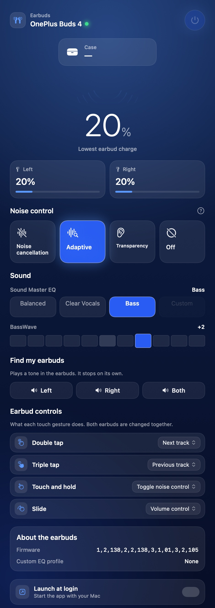
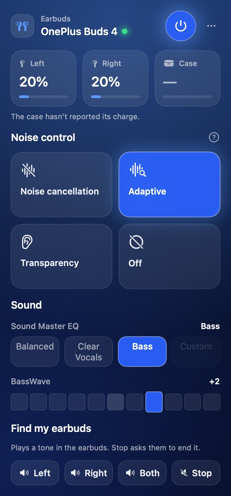
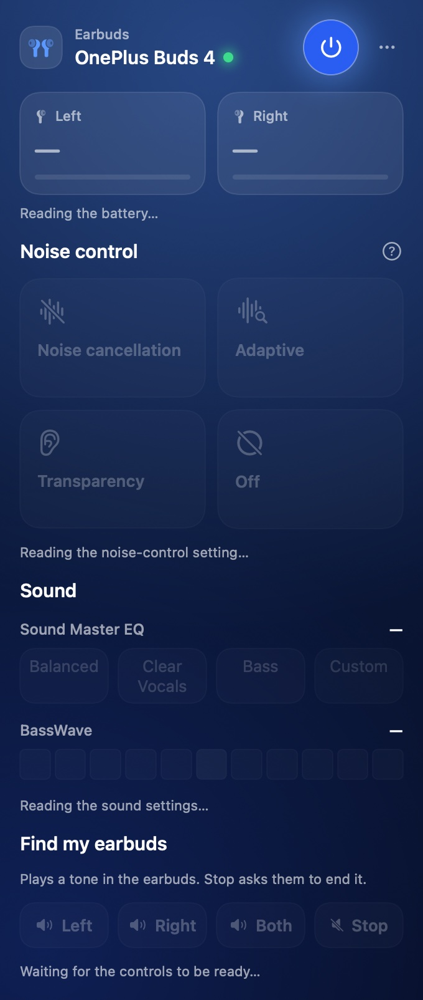
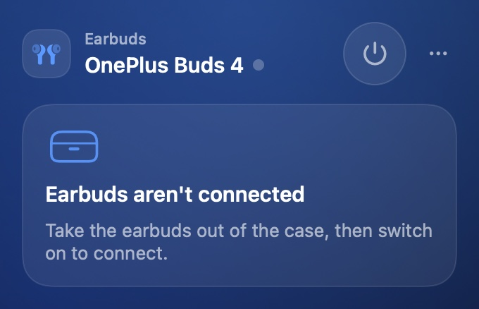

# OnePlus Buds 4 for macOS

Native SwiftUI controller for **OnePlus Buds 4** on macOS — a real, resizable app window
plus a menu-bar item, in the style of a modern control panel. No Electron, no helper
daemon, no network.

There is a website, published from `docs/` with GitHub Pages, at
<https://shashank99928.github.io/OnePlusBuds4Mac/>. The site is `docs/index.html` and
`docs/styles.css` with the images in `docs/assets/`, plus `robots.txt`, `sitemap.xml` and a
`404.html`; it has an FAQ section with `FAQPage` structured data. The only script on it is
`docs/sculpture.js`, one same-origin ES module that draws the hero's liquid sculpture with
WebGL2; when the browser cannot run it the page is exactly what it was, and no third-party
code, font or image is ever fetched.



## Features

The feature set is at parity with the phone app for everything this channel has been shown to
drive — with one deliberate exception, spelled out in [*What is not verified*](#what-is-not-verified):
the phone app's **Dual connection** screen. Everything listed below is a real write or a
readback against the hardware, not a display-only imitation.

- **Noise control** — Off, Noise cancellation (Low / Moderate / High / Auto), Transparency,
  and Adaptive, laid out as the phone app lays them out. Switching is a real write to the
  buds and every mode is read back to confirm what took effect.
- **Sound** — Sound Master EQ (Balanced / Clear Vocals / Bass, plus the Custom slot when the
  buds actually hold a profile) and **BassWave**, a −5…+5 bass emphasis.
- **Battery** — per-earbud and case levels, with a headline reading for the weaker bud, and
  an AirPods-style floating popup when the buds connect. When the case hasn't reported a
  charge, the app says so rather than leaving a number-shaped hole.
- **In-ear detection** — each slot reports whether that bud is in use, resting in the case,
  or being held.
- **Linked devices** — what the buds report as linked to them: the phone app's Dual connection
  screen, as a reading. Each entry gives its name, its state, whether it is the device the buds
  are talking to (this Mac), and whether it carries the audio. The table is pushed and also
  asked for on the same cadence as the battery, so the card follows a phone joining or leaving
  rather than freezing at what the connect-time push said. Nothing here connects or disconnects a
  peer — no setter for that has ever been seen on the wire — so the card is a fact rather than a
  control.
- **Find my earbuds** — rings the left, the right, or both, and offers a Stop that asks the
  buds to end the tone. The stop is the vendor's own exit-find request, byte for byte: their app
  has the command but no control that reaches it, which is why a phone can only wait the tone
  out. See [How the phone app does it](#how-the-phone-app-does-it).
- **Earbud controls** — remaps the media touch gestures (double tap, triple tap, touch and
  hold, slide) to what the buds actually support. Only the media context is remappable.
- **Firmware readout** — the string the earbuds report, shown exactly as they report it: a
  comma-separated list, not decoded further — and whether a custom EQ profile is saved.
- **Connect / disconnect** — power the buds from the app.
- **Launch at login** — optional, so the app is already running when the buds connect.
- **Two surfaces, one connection** — a full window and a compact menu-bar popover that
  always agree.

## Screens

| Main window |
| --- |
|  |

| Menu bar | Menu bar, just connected | Menu bar, earbuds off |
| --- | --- | --- |
|  |  |  |

The window is resizable and reachable from the Dock. The menu-bar item is the quick-glance
version: the controls you reach for while listening, and find-my-earbuds. It disappears along
with the buds when they're away; the window and Dock icon stay, so the app is never
unreachable — and the popover's "…" menu opens the window in the meantime.

The second image is the popover about a second after connecting, before the buds have answered.
It is drawn deliberately, because that state is the easiest one to leave as a grid of dashes
that read as faults, and the least likely to be looked at by hand. The third is the earbuds off —
the state the menu-bar item is in most of the time, and the one where an empty panel has to say
something rather than show nothing.

All four images are generated from the app itself (`--render-snapshots`, below), so they
cannot drift from what the app draws. They are the same files the snapshot test compares.

## Requirements

- macOS 26 or later
- OnePlus Buds 4 already paired with the Mac (System Settings → Bluetooth)
- To build: Xcode, or just the Command Line Tools

## Supported platforms

What works, and what was actually built and tested:

| Platform | Status | Notes |
| --- | --- | --- |
| macOS 26 (Tahoe) or later | Supported | targets the macOS 26 SDK, no back-deployment |
| Apple silicon | Supported | the release is a native arm64 build (M1 and later); ad-hoc signed, so the first launch needs right-click → Open |
| Intel Macs | Build from source | macOS 26 still runs on a few Intel models, but the release is arm64-only; `./build.sh` on the machine produces a working native binary |
| macOS 15 and earlier | Not supported | built against the macOS 26 SDK with no back-deployment |
| OnePlus Buds 4 | Supported | the model this was built and tested against |
| Other OPPO / realme earbuds | Untested | they share parts of the protocol and the same service, so it may work, but nothing was verified on them |
| iPhone, Android, Windows, Linux | Not applicable | this is the Mac side only; it does not replace the phone app |

Two things hold regardless of platform: the control channel is exclusive, so only one of this
app and the phone app can hold the buds at a time (whoever holds it wins), and the buds have to
be paired in System Settings → Bluetooth before the app can find them.

## Install

### Disk image

Download the DMG from [Releases](../../releases/latest), open it, and drag the app onto the
Applications shortcut.

The build is ad-hoc signed, so the first launch on a Mac that has never seen it needs
**right-click → Open**. After that it opens normally. (See [Releasing](#releasing) for how
to produce a notarized build that skips this.)

### From source

```sh
git clone https://github.com/shashank99928/OnePlusBuds4Mac.git
cd OnePlusBuds4Mac
./build.sh
open "OnePlus Buds 4.app"
```

Or build the disk image yourself:

```sh
./make-dmg.sh
open "dist/OnePlus Buds 4.dmg"
```

The image opens with the app beside an Applications shortcut, a styled background, and the
app icon as the volume icon.

## How this is verified

Everything here is checked against something that can disagree with it, because the parts of
this app that matter are the parts where being wrong is silent — the buds accept any write and
validate nothing, so a wrong command produces no error, just the wrong behaviour.

The app is `BudsBarKit`, a library, plus a four-line executable at
`Sources/OnePlusBuds4/main.swift`. That split is what lets `swift test` reach the protocol and
the views without launching the app.

- **The buds' own readbacks.** `--selfcheck` exercises the wire format in 154 checks, but the
  hardware is the only thing that settles what a write did. Every mode and level was set and
  read back; when this app sent `0x02` for Transparency the firmware stored Noise cancellation,
  which is how that bug was found.
- **A captured fixture corpus.** `Tests/Fixtures/buds4-frames.hex` holds 24 raw RFCOMM frames
  taken off the wire, with both length fields intact. Fixtures are *captured*, never typed:
  the self-check used to crash at launch because one hand-written fixture's `len` varint
  disagreed with its own payload-length field, and the parser was right to reject it. Nothing
  enters the corpus except through `Tools/freeze-fixtures.sh` from a real capture.
- **`swift test`.** 14 tests across two classes — 10 protocol tests and 4 snapshot tests. The
  checks are tests, not a launch hook: the corpus invariant, the crash as a regression test,
  the setter ids against the acknowledgements the hardware sends, the property that every
  mode the UI can offer decodes back to itself, and the property that the self-check *reports*
  a failure on a degraded corpus rather than trapping on it.
- **Golden images, at the widths the surfaces really render at.** 340pt is the popover and
  470pt is the window column; if a change makes the noise-control labels clip at either, a
  test fails rather than someone noticing three commits later. The four goldens —
  `window.png`, `panel.png`, `panel-warming.png` and `panel-disconnected.png` — are recorded in
  `Tests/BudsBarKitTests/SnapshotTests.swift` and compared per pixel against a fresh render.
  They live in the website's asset directory (`docs/assets`) on purpose, so the screenshot a
  visitor sees is the very file the test verifies — one copy, compared pixel for pixel rather
  than byte for byte, because macOS's PNG encoder does not write the same bytes twice for the
  same pixels. The individual controls the four surfaces never isolate — the Noise-cancellation
  level row, the case chip, a control channel that has dropped while its last reading is still
  on screen, the connect popup — have their own goldens in `Tests/Goldens/`, kept out of
  `docs/assets` because a lone control is not a website asset. The popup's golden draws its
  glass capsule as a plain translucent shape instead: `.glassEffect` is a compositor effect that
  `ImageRenderer` draws as nothing at all, so a golden of the real thing was blank and would
  have passed forever.
  Regenerate deliberately with `UPDATE_SNAPSHOTS=1 swift test --filter SnapshotTests` and read
  the diff.
- **A non-zero exit.** `./build.sh` runs `--selfcheck` against the release binary and fails
  the build if a check does not pass.
- **The SF Symbol names, against the running OS.** `Tools/check-symbols.swift` pulls every symbol
  name out of the drawing call sites in `Sources/` and `Tools/` and checks each against the OS
  glyph catalog, so `./build.sh` fails on a name that is not a symbol. It exists because one
  shipped: `NoiseMode.adaptive` used a name that is not in the catalog, and a missing glyph is
  invisible — the control simply drew nothing.

```sh
swift test                                        # protocol checks and golden images
./build.sh                                        # builds, then runs --selfcheck
swift .build/debug/OnePlusBuds4 --render-snapshots   # -> docs/assets
```

## What is not verified

Being explicit about the gaps, so nobody mistakes them for settled:

- **Dual connection.** The reading is closed; the writing is not. The buds push the table of
  what is linked to them and answer a request for it, and this app does both — the layout is the
  vendor SDK's own multi-connect parser, the push's records consume exactly to the last byte
  under it, and the getter's reply is in the corpus as well. What remains unverified is the other
  half: **no setter for connecting or disconnecting a peer has ever been seen on the wire**. The
  card reports; it does not control. More captures close the writing half the way the reading
  half was closed.
- **The find-my-earbuds tone.** Ringing is answered with a bare result byte, and so is the stop.
  Five payload shapes — the vendor's `[0x01]` ring and `[0x00]` stop among them — were put on the
  wire one at a time, and every one came back `0x8400 len=1 payload=[01]`: the reply says nothing
  about whether a tone started. Neither the ring nor the stop has been confirmed by ear, so the UI
  asks rather than reports. The frame itself is no longer a guess: see
  [How the phone app does it](#how-the-phone-app-does-it).
- **Slide → "Volume control".** The label is from the protocol write-up. That a slide changes
  *volume* rather than scrolling was not measured.
- **A gesture the phone changes while this app runs.** The SDK models a *push* of the gesture
  table as well as a getter, and the push's record is not the getter's: `UserInteractionEventInfo`
  is five bytes — the same four fields plus a scene — with two-byte options after them. No frame
  of that shape is in this corpus, and synthesising one to exercise a decoder against is the exact
  mistake the fixture rule exists to prevent, so the app ignores the push and asks for the table
  when the channel opens. A change made on the phone is unseen until the next connection or write.
- **Custom EQ is read-only.** The upload format has never been transmitted by anyone and there
  is no documented delete, so the app reports whether a custom profile exists and does not
  write the buds' flash.
- **Firmware updates** are out of scope entirely: the OTA path is a separate channel.
- **The charging bit.** The top bit of a battery byte is treated as "charging" — seen on this
  hardware once, and named as a mask in the vendor SDK's own `BatteryInfo`
  (`MASK_CHARGING_STATE = 128`, beside `MASK_BATTERY_LEVEL = 127`), which is the same split this
  app uses. It does not affect the level shown.
- **What a rejected write looks like.** A setter is answered with a `0x84` frame carrying the
  setter id and a sequence byte, and those acks are in the corpus. The vendor's parser reads the
  first payload byte as a status — `0` accepted, anything else declined — and every ack in the
  corpus carries `0`, so that reading is plausible; but the find reply answers `1` to every
  request, accepted or not, so the app still does not act on an ack. A write the buds decline is
  not reported as an error; it appears as the control snapping back to the old value on the next
  readback, a few seconds later.
- **Which reply wins.** Readbacks carry a sequence byte. It has been measured once — the
  multi-connect getter's three replies each echoed the request's sequence, `0x32`, `0x33`, `0x34`
  — but one getter is not all of them, so the app does not yet use the byte to discard stale
  replies. If a slow reply lands after a newer one, a control can briefly show the previous value
  until the next poll — seconds later. The acks and this ordering are the two places where more
  captures would turn a design decision into a check.

## The protocol

The buds expose a vendor RFCOMM channel under the `oppointeraction` service. Three families of
frame share one varint framing:

| Family | Message type | How a frame is addressed |
| --- | --- | --- |
| 1 | `0x02` | Command byte is always `0x04`; `payload[0]` is a topic (battery, wear, ANC) |
| 2 | `0x05` | The command byte names the subject on its own numbering |
| 3 | `0x04` | Setter, acknowledged by a `0x84` frame addressed back to the setter id |

The setter ids are a **separate namespace** from the getters — BassWave writes to `0x1B` and
reads from `0x24` — and a setter's payload is its getter's reply payload minus the status
byte, which is why one set of decoders serves both. The community write-ups credited at the
end of this file are what the format was cross-checked against; the captured corpus is what
settled it, and `swift test` is what keeps it settled.

One thing the corpus settled by repetition: **the battery reply carries left and right only.**
Over a single session, 60 of 60 battery replies had a pair count of 2 while the wear reply named
the case slot on every poll — so the case's charge is not something this channel sends while the
buds are out of the case, whatever the phone app reads it from. The app still draws a case chip,
because the wear report is real evidence that a case is there, but it labels that chip "Not
reported" instead of leaving a dash that reads like a value still loading.

A second notification topic is read back the same way, and it is also the protocol's one
non-notification read that does not come from a battery-style getter. Topic `0x06` is the **multi-connect
table** — the buds' own list of what is linked to them — and its body is a count followed by
that many records of six address bytes, a length byte, a state byte, a flag byte, a name length
and the name. The length byte is `3 + nameLength`, which is what makes it a stride rather than a
guess: in the corpus frame the two records begin at offsets 1 and 35 of a 55-byte body and the
second ends exactly at the last byte. A body that does not add up — a record running past the
end, a length byte that disagrees with the name it precedes, a count promising more records than
are there — yields **no update at all**, so a half-read list can never reach the UI dressed as a
fact. The layout itself is the vendor SDK's, below. The same table answers a request: `0x12` with
an empty payload is the vendor's own getter, and its reply is the same body with a status byte in
front of it, so one decoder serves the push and the poll. The app asks for it on the same cadence
as the battery and the wear report, because the push is not always timely — in this project's own
corpus a push and a reply a second apart disagree about whether the phone was connected.

## How the phone app does it

The phone app's own protocol stack is the second opinion this protocol deserves. `HeyMelody`
(`com.heytap.headset`, 116.9.0, APK SHA-256
`89368eb2b33abbec1c783b70439679eb0f0a9fea56706999122ab8a3d0ca13b5`) carries its Bluetooth SDK
in `com.oplus.melody.btsdk`; it was decompiled with JADX to read. Reading it settled a family of
questions the captures could only hint at, and one thing no capture can show.

- **The two bytes are one 16-bit id.** The SDK's `Packet` parses a body as a 16-bit
  **little-endian** command id, then a sequence byte, then a 16-bit payload length, then the
  payload — and bit 15 of the id means "this is a reply". So the byte this app calls `cmd` and
  the one it calls `messageType` are the low and high halves of a single number, which is what
  `Frame.opcode` already assumes. The SDK's reply table names the same ids this app derived from
  the wire: `isFindModeRsp()` is `33792` (`0x8400` — `cmd 0x00`, a `0x84` ack),
  `isNoiseReductionRsp()` is `33796` (`0x8404`, the corpus's `setack-anc`), and
  `isSetEqInfoRsp()` is `33816` (`0x8418`).
- **Find is one command whose payload is on or off.** `HeadsetCoreService` sends SDK command
  `1024` — `0x0400`, which is `cmd 0x00` with `messageType 0x04` — and its payload is a single
  byte: `[0x01]` starts the tone, `[0x00]` ends it. Their exit-find state machine reaches that
  `[0x00]` through `EarphoneRepository.m0(address, false)`. This app's Stop sends the same frame,
  so the stop is the vendor's own request rather than this project's guess about ringing nothing.
- **Their tone session is bounded.** Entering find mode arms a three-second timer for the
  acknowledgement; the tone itself gets a fifty-second timer; a stop-tone event, a dropped
  connection or leaving the screen ends the session. Starting a tone is refused outright when the
  wear report says both earbuds are in the case, which is why this app's find section says that
  too instead of offering a button that cannot do anything.
- **Why their app has no stop button.** Their completion handler reads the find reply as a status
  and treats `0` as success. The firmware answers the ack id `0x8400` with the payload `[0x01]`
  for *every* find request, accepted or not, so the app concludes the ring failed, drops to idle,
  and never reaches the state that sends the stop — while the tone plays on. That is the
  behaviour the phone offers, and it is the reason this app has a Stop at all.
- **What the wire still cannot say.** Five payload shapes were sent to this hardware one at a
  time — the vendor's `[0x00]` and `[0x01]`, and this app's `[0x01, 0x01]`, `[0x01, 0x02]` and
  `[0x02, 0x01, 0x02]` — and every one was answered identically with `0x8400 len=1 payload=[01]`.
  Nothing separates a ring from a stop on the wire. Nor does the vendor's app ever name a single
  bud: their find call is per-device and their screen has one play button. Per-earbud ringing is
  therefore this app's extension of the vocabulary, not something the phone does, and whether it
  and the stop are honoured is settled by ear rather than by a trace.
- **The device table is a real structure, not a blob.** Notification `0x0204` with `payload[0]`
  `6` is dispatched to the SDK's own multi-connect parser, which decodes it as
  `[count][six address bytes][length][state][flags][nameLength][name]` and strides by
  `7 + length`. That is where this app's decoder comes from — not from fitting bytes to one
  sample. The same parser supplies the state numbering their screen switches on (`1` connecting,
  `2` connected, `4` disconnecting; `0` their list treats as available to connect) and the flag
  bits (`0x01` the current device, `0x02` main audio, `0x04` audio active, `0x38` a device type
  their icon table renders as `1` phone, `2` computer, `3` tablet, `4` watch). The matching
  getter is SDK command `274` (`0x12`) with an empty payload: sending it exactly as they do got
  the table back — the push's body behind a status byte, the request's sequence echoed — and that
  reply is in the corpus, which is what lets this app poll the table rather than wait to be told.
- **Their battery record is two bytes, and they sometimes pad it.** The SDK's `BatteryInfo`
  reads a battery entry as `LENGTH_REMOTE_BATTERY_LEVEL = 2`, masks the level with `127` and the
  charging flag with `128` — the split this app arrived at from the captures, now with a second
  opinion for it. One difference worth knowing: before showing a level, their `fixBattery` rounds
  it **up** to the next multiple of the model's grid (its `batteryRadix`, default `10`), so a byte
  of `23` is displayed as `30`. Every level this hardware has reported is already a multiple of
  ten, so the two agree here; this app shows the byte as it came.
- **The gesture record is four bytes there, and so are its names.** `KeyFunctionInfo` reads them
  as `deviceType` (`1` left, `2` right), `button` (`1` is where the media gestures live; the
  corpus's other value, `6`, is the call scene this app leaves alone), `buttonAction` and
  `function`. One label this app had been taking from the write-up is now confirmed by name:
  `buttonAction 4` is tested by a class called `LongPressVolumeChildFragment`, so "Touch and hold"
  is the long press rather than an assumption. Their gesture-test screen names a single, double,
  triple and long sequence in that order (`spSingleClick*` through `spLongClick*`), which is where
  the write-up's `2` double and `3` triple come from as well. The app offers the four codes a
  gesture can be configured to (`2`–`5`) and leaves `buttonAction 1`, the single tap, alone: the
  corpus holds that record with action `none`, and nothing captured here shows the phone offering
  single tap for this model.
- **Their action list runs past the codes this app offers.** The corpus's `function` values are
  `0` and `5`–`8` — nothing, previous, next, volume control, noise control, all of which the app
  offers — plus `0x1c` and `0x1d` in the call scene, while the SDK's own screen tests for `17`
  (game mode), `25` (AI summary) and `26`/`27` (AI translation), each behind a per-model feature
  flag their app reads from a config this one cannot see (`WhitelistConfigDTO.Function`). A code
  offered because the vendor's list has it, on a model whose config does not, is a menu entry that
  does nothing, so the app offers the codes this hardware has been seen to store.
- **The table is read-only because the wire says so.** Their screen can connect and disconnect a
  peer, but that goes through an app-side flow rather than a captured setter: no frame this
  project has seen names a multi-connect slot to change. So this app reports the table and offers
  no buttons for it, the same line the app draws everywhere else.

## Releasing

The scripts take an optional Developer ID identity and notarization profile, so a release
build is signed with the hardened runtime, timestamped, and stapled:

```sh
export SIGN_IDENTITY="Developer ID Application: Your Name (TEAMID)"
export NOTARY_PROFILE="your-notarytool-profile"   # xcrun notarytool store-credentials …
./make-dmg.sh
```

Without `SIGN_IDENTITY` the app is ad-hoc signed, which is fine for personal use and for
running from a build directory.

## Privacy

Bluetooth is used only to talk to paired earbuds, over their vendor RFCOMM control channel.
No network requests, no analytics, no telemetry, and no Bluetooth address is baked into the
source — the app identifies the buds by the `oppointeraction` service they advertise.

## Generated artwork

The icon, the disk-image background, the screenshots and the website's art are generated, not
hand-drawn, so they can be regenerated after a design change:

```sh
swift Tools/make-icon.swift             # -> Resources/AppIcon.icns, docs/assets/{icon,favicon}.png
swift Tools/make-dmg-background.swift   # -> Resources/dmg-background{,@2x}.png
swift .build/debug/OnePlusBuds4 --render-snapshots
                                        # -> docs/assets/{window,panel,panel-warming,panel-disconnected}.png
swift Tools/make-site-assets.swift      # -> docs/assets/*.jpg, hero.jpg, og.png
swift Tools/make-sculpture.swift        # -> docs/assets/sculpture.png
./Tools/freeze-fixtures.sh              # re-freeze the fixture corpus from the .hex record
```

`--render-snapshots` takes an optional directory and defaults to `docs/assets` — the goldens'
own directory — and draws every surface and exits. Because the images the README shows
and the images the test compares are the same files, there is no second copy to go stale.
`make-sculpture.swift` is the odd one out: it draws the hero's artwork rather than a
screenshot, so `make-site-assets.swift` deliberately skips it when deriving the JPEGs.

All outputs are committed, so `./build.sh` and `./make-dmg.sh` work without running them.

### Re-capturing fixtures

To capture new frames from the hardware: connect the buds, then

```sh
BUDSBAR_TRACE=1 BUDSBAR_HARVEST=1 \
  "./OnePlus Buds 4.app/Contents/MacOS/OnePlusBuds4" 2>capture.log
```

`BUDSBAR_TRACE` dumps every raw frame; `BUDSBAR_HARVEST` additionally sweeps each mode, level,
EQ preset and BassWave setting so the capture contains one clean example of every frame type,
and restores what it found. It only ever writes values from the allow-listed setters. Keep the
`RX …` lines in `Tests/Fixtures/buds4-frames.hex`, then run `Tools/freeze-fixtures.sh`.

## Troubleshooting

- **The buds never appear.** Confirm they're paired and connected in
  System Settings → Bluetooth. The app finds them by the control service they advertise, so
  a pair that isn't connected yet shows as not paired.
- **macOS asks for Bluetooth permission.** Allow it. The bundle identifier is stable across
  rebuilds so the grant survives, though re-signing can occasionally re-prompt.
- **The menu-bar icon is missing.** It's intentional: the item hides while the buds are
  away. Use the window (or the Dock icon) in the meantime.
- **"App is damaged" / Gatekeeper refuses to open.** Right-click the app → Open. Or sign
  and notarize it as shown in [Releasing](#releasing).
- **Only one of the app and the phone app can control the buds.** The control channel is
  exclusive; whoever holds it wins. Quit the phone app's session if the app cannot open it.

## Layout

| Path | |
| --- | --- |
| `Sources/BudsBarKit/App.swift` | Scenes, the menu-bar item, the window bridge, the entry point |
| `Sources/BudsBarKit/Buds.swift` | Bluetooth state and the vendor control channel |
| `Sources/BudsBarKit/Protocol.swift` | `oppointeraction` wire format, and the self-check |
| `Sources/BudsBarKit/Controls.swift` | Reusable controls shared by the window and popover |
| `Sources/BudsBarKit/Theme.swift` | Colours and the shared surface styling |
| `Sources/BudsBarKit/MainWindowView.swift` | The main window |
| `Sources/BudsBarKit/PanelView.swift` | The menu-bar popover |
| `Sources/BudsBarKit/FloatingBatteryView.swift` | The AirPods-style connect popup |
| `Sources/BudsBarKit/FloatingPanelController.swift` | Positions and shows that popup |
| `Sources/BudsBarKit/Snapshots.swift` | Renders every surface for the goldens and `--render-snapshots` |
| `Sources/BudsBarKit/FixtureCorpus.swift` | The captured frames, frozen (generated) |
| `Sources/BudsBarKit/LaunchAtLogin.swift` | `SMAppService`-backed launch-at-login |
| `Sources/OnePlusBuds4/main.swift` | The whole executable: one call into the library |
| `Tests/BudsBarKitTests/ProtocolTests.swift` | The protocol checks, as tests |
| `Tests/BudsBarKitTests/SnapshotTests.swift` | The golden-image comparisons; the four site goldens are recorded here |
| `Tests/Fixtures/buds4-frames.hex` | The capture of record |
| `Tests/Goldens/` | The component goldens — test-only, kept out of `docs/assets` (see `Snapshots.png(_:width:)`) |
| `docs/index.html` | The website, published from `docs/` with GitHub Pages |
| `docs/styles.css` | The website's styling |
| `docs/sculpture.js` | The hero's WebGL2 sculpture; the site's only script, optional by design |
| `docs/assets/` | The goldens and their web JPEG derivatives, plus `hero.jpg`, `og.png`, `icon.png`, `favicon.png`, `sculpture.png` |
| `Tools/freeze-fixtures.sh` | Regenerates the frozen corpus from the capture |
| `Tools/check-symbols.swift` | Validates every SF Symbol name in the source against the running OS |
| `Tools/make-icon.swift` | Renders the app icon, the `.icns` and the web icon |
| `Tools/make-sculpture.swift` | Draws the hero's artwork (`docs/assets/sculpture.png`) |
| `Tools/make-site-assets.swift` | Derives the website's JPEGs, hero crop and social card from the goldens |
| `Tools/make-dmg-background.swift` | Renders the disk-image background |
| `Tools/sniff.swift` | Read-only RFCOMM recon logger (development) |

## License

MIT — see [LICENSE](./LICENSE).

The wire format was reverse-engineered with, and cross-checked against, the open-source
"Realme TWS Mac Controller" project (MIT) and the community `oppointeraction` protocol
write-ups. This project is not affiliated with OnePlus or realme.
