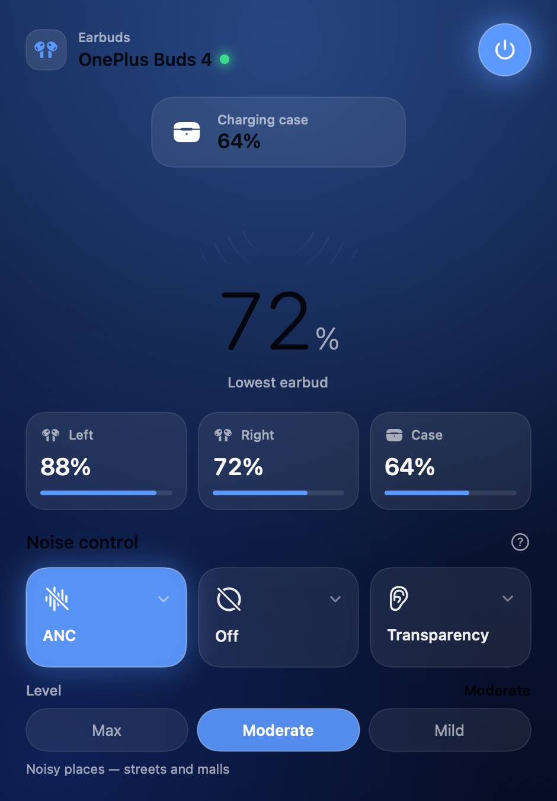
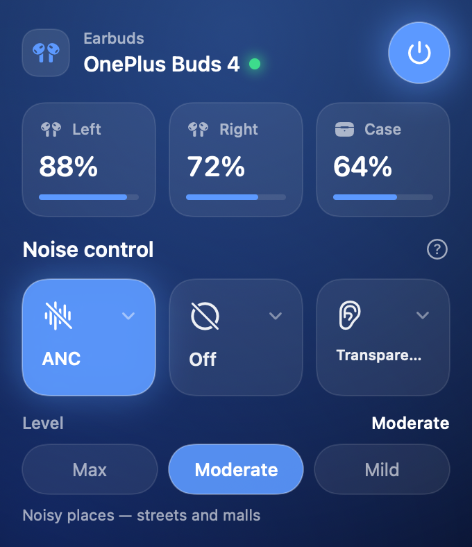

# OnePlus Buds 4 for macOS

Native SwiftUI controller for **OnePlus Buds 4** on macOS — a real, resizable app window
plus a menu-bar item, in the style of a modern control panel. No Electron, no helper
daemon, no network.



## Features

- **Battery at a glance** — per-earbud and case levels, with a headline reading for the
  weaker bud and an AirPods-style floating popup when the buds connect.
- **Noise control** — Off, Transparency, and ANC in Mild / Moderate / Max, plus the
  current level's plain-language description ("Noisy places — streets and malls").
- **In-ear detection** — each slot reports whether that bud is in use, in the case, or
  worn out.
- **Connect / disconnect** — power the buds from the app.
- **Launch at login** — optional, so the app is already running when the buds connect.
- **Two surfaces, one connection** — a full window and a compact menu-bar popover that
  always agree.

## Screens

| Main window | Menu bar |
| --- | --- |
|  |  |

The window is resizable and reachable from the Dock. The menu-bar item is the quick-glance
version. It disappears along with the buds when they're away; the window and Dock icon
stay, so the app is never unreachable.

## Requirements

- macOS 26 or later
- OnePlus Buds 4 already paired with the Mac (System Settings → Bluetooth)
- To build: Xcode, or just the Command Line Tools

## Install

### Disk image

Download the DMG from [Releases](../../releases/latest), open it, and drag the app onto the
Applications shortcut.

The build is ad-hoc signed, so the first launch on a Mac that has never seen it needs
**right-click → Open**. After that it opens normally. (See [Releasing](#releasing) for how
to produce a notarized build that skips this.)

### From source

```sh
git clone https://github.com/shashank99928/OnePlusBuds4Mac.git
cd OnePlusBuds4Mac
./build.sh
open "OnePlus Buds 4.app"
```

Or build the disk image yourself:

```sh
./make-dmg.sh
open "dist/OnePlus Buds 4.dmg"
```

The image opens with the app beside an Applications shortcut, a styled background, and the
app icon as the volume icon.

## Releasing

The scripts take an optional Developer ID identity and notarization profile, so a release
build is signed with the hardened runtime, timestamped, and stapled:

```sh
export SIGN_IDENTITY="Developer ID Application: Your Name (TEAMID)"
export NOTARY_PROFILE="your-notarytool-profile"   # xcrun notarytool store-credentials …
./make-dmg.sh
```

Without `SIGN_IDENTITY` the app is ad-hoc signed, which is fine for personal use and for
running from a build directory.

## Privacy

Bluetooth is used only to talk to paired earbuds, over their vendor RFCOMM control channel.
No network requests, no analytics, no telemetry, and no Bluetooth address is baked into the
source — the app identifies the buds by the `oppointeraction` service they advertise.

## Generated artwork

The icon and the disk-image background are generated, not hand-drawn, so they can be
regenerated after a design change:

```sh
swift Tools/make-icon.swift             # -> Resources/AppIcon.icns
swift Tools/make-dmg-background.swift   # -> Resources/dmg-background{,@2x}.png
```

Both outputs are committed, so `./build.sh` and `./make-dmg.sh` work without running them.

## Troubleshooting

- **The buds never appear.** Confirm they're paired and connected in
  System Settings → Bluetooth. The app finds them by the control service they advertise, so
  a pair that isn't connected yet shows as not paired.
- **macOS asks for Bluetooth permission.** Allow it. The bundle identifier is stable across
  rebuilds so the grant survives, though re-signing can occasionally re-prompt.
- **The menu-bar icon is missing.** It's intentional: the item hides while the buds are
  away. Use the window (or the Dock icon) in the meantime.
- **"App is damaged" / Gatekeeper refuses to open.** Right-click the app → Open. Or sign
  and notarize it as shown in [Releasing](#releasing).

## Layout

| Path | |
| --- | --- |
| `Sources/BudsBar/App.swift` | App scenes, the menu-bar item, the window bridge |
| `Sources/BudsBar/Buds.swift` | Bluetooth state and the vendor control channel |
| `Sources/BudsBar/Protocol.swift` | `oppointeraction` wire format |
| `Sources/BudsBar/Theme.swift` | Colours and the shared surface styling |
| `Sources/BudsBar/Controls.swift` | Reusable controls shared by the window and popover |
| `Sources/BudsBar/MainWindowView.swift` | The main window |
| `Sources/BudsBar/PanelView.swift` | The menu-bar popover |
| `Sources/BudsBar/LaunchAtLogin.swift` | `SMAppService`-backed launch-at-login |
| `Tools/sniff.swift` | Read-only RFCOMM recon logger (development) |

## License

MIT — see [LICENSE](./LICENSE).

Based on the open-source "Realme TWS Mac Controller" project (MIT).
